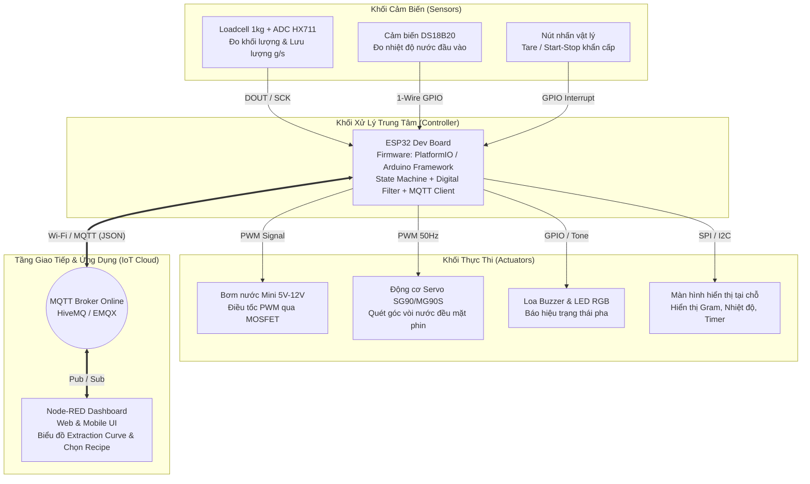
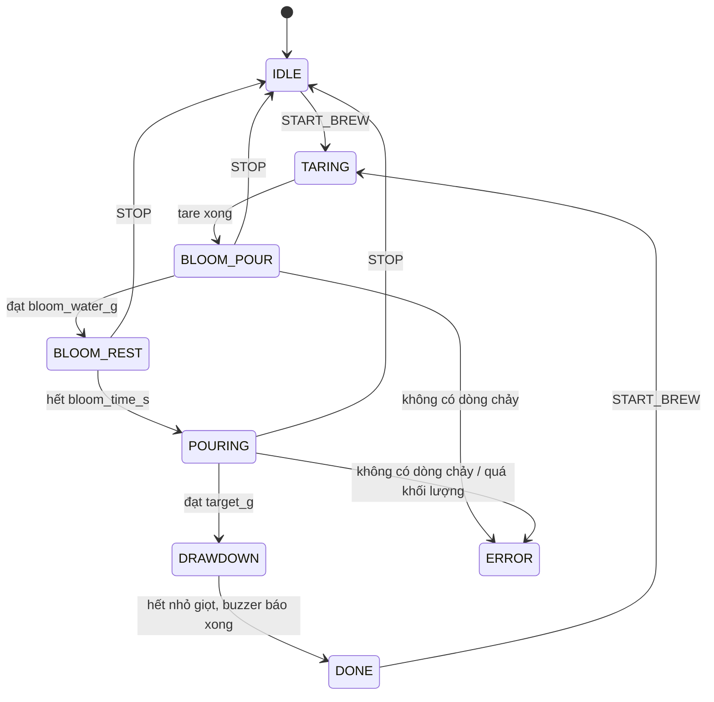
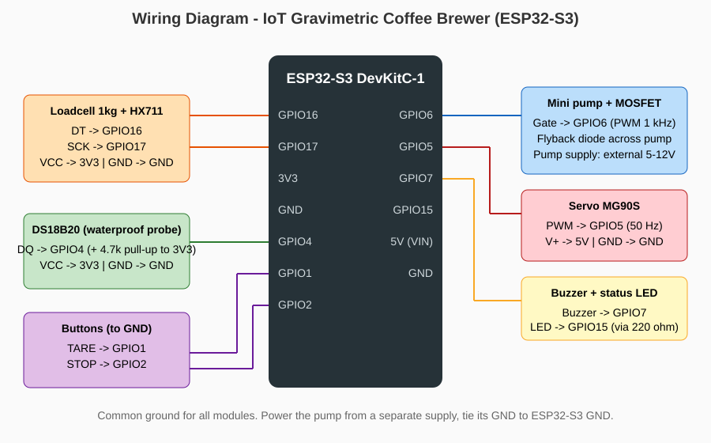

# PHY3640 - IoT Gravimetric Coffee Brewer
**Hệ thống Pha Cà Phê Phin & Pour-Over Tự Động Kiểm Soát Theo Trọng Lượng Thực Tế**

> Đồ án cuối kỳ môn **PHY3640 – IoT Apps Dev (Fall 2026)** · ESP32 · PlatformIO/Arduino · MQTT · Node-RED Dashboard · Wokwi

---

## 1. Đặt bài toán & Cảm hứng thực tế (Problem Statement & Motivation)

### Nhu cầu thực tế
Trong quá trình học tập và làm việc kỹ thuật vào ban đêm, việc pha một ly cà phê Phin truyền thống hoặc Pour-Over thường gặp hai vấn đề lớn:
1. **Sai lệch tỷ lệ chiết xuất (Brew Ratio):** Các máy pha cà phê dân dụng giá rẻ chỉ bơm nước dựa trên thời gian cố định (Timed Dosing). Khi bột cà phê nén chặt hoặc mịn hơn, nước chảy chậm làm lệch hoàn toàn tỷ lệ vàng (thường là `1:12` cho Phin đậm hoặc `1:15` cho Pour-Over), khiến cà phê lúc quá đắng gắt, lúc lại quá nhạt.
2. **Bỏ qua giai đoạn ủ (Blooming Phase):** Cà phê rang xay cần được rót một lượng nước nhỏ (khoảng 2 đến 2.5 lần khối lượng bột) và nghỉ 30–40 giây để giải phóng khí $CO_2$ trước khi rót phần nước chính. Rót tay thủ công rất dễ quên căn giờ hoặc rót quá tay.

### Tính sáng tạo & Cảm hứng từ Hackaday
Lấy cảm hứng từ các cân cà phê thông minh đắt đỏ (như Acaia Lunar) và các dự án máy pha tự động mã nguồn mở trên **Hackaday.io**, dự án này xây dựng một **hệ thống điều khiển vòng kín theo trọng lượng (Closed-Loop Gravimetric Control)**:
- Thay vì đếm giây mù quáng, **ESP32** đọc khối lượng nước thực tế chảy vào phin/cốc theo thời gian thực qua cảm biến lực **Loadcell + HX711** để tính **tốc độ dòng chảy tức thời ($\text{Flow Rate} = \Delta m / \Delta t$, đơn vị $\text{g/s}$)**.
- Tự động điều chỉnh xung **PWM cho bơm nhu động/bơm mini** và góc quét của **động cơ Servo** để phân bổ nước đều trên bề mặt bột cà phê.
- Đồng bộ toàn bộ **Đường cong chiết xuất (Extraction Curve)** lên **Node-RED Dashboard** qua giao thức **MQTT**, cho phép chọn công thức pha (Phin truyền thống / V60 Pour-Over) và kích hoạt pha từ điện thoại thông minh.

### Bài toán vật lý
- **Loadcell (strain gauge) + cầu Wheatstone:** lực làm thanh nhôm biến dạng → điện trở strain gauge thay đổi → cầu Wheatstone cho ra điện áp vi sai cỡ mV → **HX711** (ADC 24-bit, khuếch đại PGA 128) → ESP32.
- **Lưu lượng khối lượng:** $\dot m = \dfrac{m(t) - m(t-\Delta t)}{\Delta t}$ (g/s), tính trên cửa sổ trượt 6 mẫu (~1 s) sau bộ lọc EMA.
- **Điều khiển vòng kín:** bộ điều khiển P điều chỉnh duty PWM của bơm để lưu lượng bám theo giá trị đặt $2.5\ \text{g/s}$, giảm tốc khi còn < 15 g để dừng chính xác tại khối lượng mục tiêu.
- **Nhiệt độ:** DS18B20 giám sát nước trong khoảng $88^\circ\text{C} - 94^\circ\text{C}$.

---

## 2. Nội dung chính & Tính năng hệ thống (Key Features)

1. **Cân tự động & Trừ bì thông minh (Auto-Tare):** Tự động về 0g khi đặt cốc/phin lên bàn cân trước khi bắt đầu chu trình.
2. **Chu trình pha 3 giai đoạn (3-Stage Brewing State Machine):**
   - **Stage 1 – Pre-infusion (Ủ cà phê):** Bơm chính xác lượng nước ủ (ví dụ: 30g nước cho 15g cà phê), dừng bơm và đếm ngược 35 giây để thoát khí $CO_2$.
   - **Stage 2 – Active Extraction (Chiết xuất kiểm soát lưu lượng):** Bơm phần nước còn lại đến đúng khối lượng mục tiêu (ví dụ: 225g) trong khi Servo quay đảo vòi rót theo góc xoắn ốc, duy trì tốc độ rót ổn định $2.0 - 3.0\text{ g/s}$.
   - **Stage 3 – Drawdown & Alert (Róc nước & Báo hiệu):** Theo dõi tốc độ nhỏ giọt cuối chu trình; phát âm báo qua **Loa/Buzzer** và gửi thông báo lên Dashboard khi ly cà phê hoàn tất.
3. **Giám sát nhiệt độ nước (Thermal Interlock):** Đọc nhiệt độ bình nước qua cảm biến **DS18B20**; cảnh báo trên Dashboard nếu nước chưa đạt ngưỡng chiết xuất tiêu chuẩn ($88^\circ\text{C} - 94^\circ\text{C}$).
4. **Điều khiển & Giám sát qua MQTT + Node-RED Dashboard:**
   - Chọn cấu hình pha (Profile: *Vietnamese Phin 1:10*, *Classic Pour-Over 1:15*, *Strong Night-Shift 1:12*).
   - Đồ thị thời gian thực hiển thị song song **Tổng khối lượng (g)** và **Tốc độ rót (g/s)**.
5. **An toàn:** dừng bơm khi 15 s không thấy khối lượng tăng (hết nước / lệch cốc), khi vượt khối lượng mục tiêu +20 g, hoặc khi bấm nút **STOP** / gửi lệnh `STOP`.

---

## 3. Sơ đồ khối hệ thống (System Block Diagram)



### Máy trạng thái (Firmware State Machine)



---

## 4. Danh sách phần cứng & Sơ đồ kết nối (Hardware & Pinout)

| Thành phần | Linh kiện cụ thể | Chân kết nối ESP32 (Dự kiến) | Vai trò trong hệ thống |
| :--- | :--- | :--- | :--- |
| **Vi điều khiển** | ESP32 DevKit V1 / ESP32-C3 | — | Xử lý thuật toán cân, State Machine và kết nối Wi-Fi/MQTT |
| **Cảm biến trọng lượng** | Loadcell 1kg + Module HX711 | `GPIO 16` (DT), `GPIO 17` (SCK) | Đo khối lượng nước (độ phân giải 0.1g) và tính tốc độ chảy |
| **Cảm biến nhiệt độ** | DS18B20 (Đầu dò chống nước) | `GPIO 4` (1-Wire, trở kéo 4.7kΩ) | Kiểm tra nhiệt độ nước trước và trong khi pha |
| **Cơ cấu bơm** | Bơm nước mini DC + Module MOSFET | `GPIO 25` (PWM) | Bơm nước định lượng theo chu trình ủ và chiết xuất |
| **Cơ cấu đảo vòi** | Động cơ Servo MG90S | `GPIO 26` (PWM) | Xoay vòi nước phân bổ đều lên bề mặt bột cà phê |
| **Âm thanh & Đèn** | Buzzer + LED trạng thái | `GPIO 27` (Buzzer), `GPIO 2` (LED) | Phát âm báo khi hoàn tất giai đoạn ủ và khi pha xong |
| **Nút nhấn** | 2 nút nhấn (nối GND, `INPUT_PULLUP`) | `GPIO 32` (Tare), `GPIO 33` (Stop) | Trừ bì thủ công / dừng khẩn cấp |
| **Hiển thị tại chỗ** | Màn hình TFT 128x128 / OLED | Cụm chân SPI / I2C | Hiển thị khối lượng, thời gian và trạng thái ngay trên máy *(mở rộng)* |
| **Khung cơ khí** | Vỏ & Giá đỡ in 3D (PLA/PETG) | — | Cách nhiệt bàn cân Loadcell và cố định trục vòi Servo |



### Ảnh chụp phần cứng dự kiến & Mô phỏng Wokwi
<!-- Thêm ảnh thật vào thư mục assets/ rồi bỏ comment các dòng dưới:


-->
*(Ảnh linh kiện thực tế và ảnh chụp mô phỏng Wokwi sẽ được cập nhật trong thư mục [`assets/`](assets/). Sơ đồ mạch Wokwi có sẵn trong [`diagram.json`](diagram.json).)*

---

## 5. Thiết kế Giao thức MQTT (MQTT Topic Architecture)

- **MQTT Broker:** `broker.hivemq.com` (hoặc EMQX Cloud cá nhân), Port `1883` (TCP) / `8883` (TLS).
- **Topic Publish (ESP32 gửi dữ liệu lên Node-RED mỗi 250ms khi đang pha):**
  - Topic: `phy3640/quang/coffee/telemetry`
  ```json
  {
    "state": "POURING",
    "weight_g": 112.4,
    "target_g": 225.0,
    "flow_rate_gps": 2.4,
    "water_temp_c": 91.5,
    "elapsed_s": 58,
    "servo_angle": 45
  }
  ```
  *(Firmware gửi thêm các trường `recipe`, `temp_ok`, `pump_duty`, `message`.)*
- **Topic Subscribe (Node-RED gửi lệnh cấu hình và điều khiển xuống ESP32):**
  - Topic: `phy3640/quang/coffee/command`
  ```json
  {
    "action": "START_BREW",
    "recipe_name": "Phin_Dam_Da",
    "coffee_dose_g": 20.0,
    "ratio": 10,
    "bloom_water_g": 40.0,
    "bloom_time_s": 35
  }
  ```
  Các `action` khác: `STOP`, `TARE`.
- **Topic trạng thái thiết bị:** `phy3640/quang/coffee/status` (`online` / `offline` – Last Will, retained).

---

## 6. Kế hoạch thực hiện (Implementation Roadmap)

- **Tuần 1–2:** Hoàn thiện đề cương, dựng mạch mô phỏng trên **Wokwi** (ESP32 + HX711 + DS18B20 + Servo + LED PWM) và thiết kế giao diện **Node-RED Dashboard**.
- **Tuần 3–4:** Thiết kế và in 3D khung bàn cân cách nước/cách nhiệt cùng tay đỡ vòi rót; lắp ráp phần cứng thực tế.
- **Tuần 5–6:** Hiệu chuẩn hệ số `calibration_factor` cho Loadcell, tinh chỉnh bộ lọc trung bình trượt (Moving Average / Kalman) chống nhiễu rung khi nước chảy và hoàn thiện báo cáo cuối kỳ.

---

## 7. Cấu trúc repo & Cách chạy thử

```
├── platformio.ini          # PlatformIO (ESP32 + thư viện)
├── include/config.h        # Chân GPIO, Wi-Fi, MQTT, thông số điều khiển
├── src/main.cpp            # Firmware: state machine, EMA, flow rate, MQTT
├── diagram.json            # Sơ đồ mạch Wokwi
├── wokwi.toml              # Cấu hình Wokwi (VS Code / CLI)
├── nodered/flows.json      # Flow Node-RED + Dashboard
└── assets/                 # Sơ đồ đấu dây, ảnh phần cứng, ảnh Wokwi
```

1. **Build firmware:** `pio run` (hoặc mở thư mục bằng VS Code + PlatformIO).
2. **Mô phỏng Wokwi:** cài extension *Wokwi for VS Code*, chạy `pio run`, mở `diagram.json` → *Start Simulation*. Kéo thanh trượt trọng lượng của HX711 để mô phỏng nước chảy vào cốc. Trong Wokwi, LED `PUMP` thể hiện độ sáng theo duty PWM của bơm.
3. **Node-RED:** cài `node-red-dashboard`, *Import* [`nodered/flows.json`](nodered/flows.json), Deploy, mở `http://localhost:1880/ui`.
4. **Đổi topic:** nếu dùng broker công cộng, nên đổi `quang` trong topic thành chuỗi riêng để tránh trùng với người khác (sửa ở `include/config.h` và flow Node-RED).

### Hiệu chuẩn Loadcell
1. Đặt `HX711_CAL_FACTOR = 1.0`, nạp firmware, ghi lại giá trị thô khi đặt vật chuẩn đã biết khối lượng (ví dụ cân 100 g).
2. `calibration_factor = giá_trị_thô / khối_lượng_chuẩn(g)`, cập nhật vào `include/config.h`.
3. Kiểm tra lại với nhiều khối lượng khác nhau và chỉnh `EMA_ALPHA` nếu đồ thị bị nhiễu.

---

## 8. Ba mẹo kỹ thuật áp dụng trong dự án

1. **Mô phỏng 100% trên Wokwi trước khi ráp mạch thật** – ESP32, HX711 (có thanh trượt chỉnh gram), DS18B20, Servo, Buzzer đều có sẵn.
2. **Chống nhiễu Loadcell khi nước rơi:** firmware dùng bộ lọc **EMA** (`EMA_ALPHA = 0.3`) kết hợp cửa sổ trượt 6 mẫu để lấy đạo hàm lưu lượng $\dot m = \frac{m(t)-m(t-\Delta t)}{\Delta t}$, giúp đường cong trên Node-RED mượt như cân thương mại.
3. **Khung in 3D trên Anycubic Kobra 2 Neo – chống trôi điểm 0 do nhiệt (thermal drift):** thêm tấm đế cách nhiệt (PETG/PLA) có khe thoáng khí khoảng 5 mm giữa đáy cốc và bề mặt bắt vít của Loadcell, tránh cốc nóng truyền nhiệt trực tiếp vào thanh nhôm.

---

## 9. Tài liệu tham khảo (References)

1. [Hackaday.io – Open Source IoT Pour-Over Coffee Machines & Smart Scales](https://hackaday.com/?s=pour+over+coffee)
2. Avia Semiconductor, *HX711 24-Bit Analog-to-Digital Converter (ADC) for Weigh Scales Datasheet*.
3. Maxim Integrated, *DS18B20 Programmable Resolution 1-Wire Digital Thermometer Datasheet*.
4. [PlatformIO Documentation – Espressif 32 Platform](https://docs.platformio.org/en/latest/platforms/espressif32.html)
5. [Node-RED Dashboard Documentation](https://flows.nodered.org/node/node-red-dashboard)
